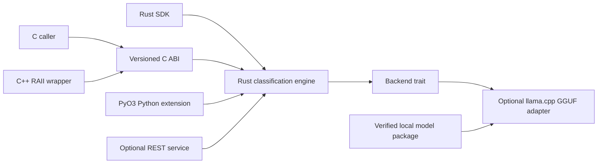

# ADR-0001: Local inference and SDK boundaries

Status: Accepted architectural decision under FDEC-005. Implementation status is
separate: core schema exists; inference, SDK APIs, C ABI and REST remain planned.
Source baseline: 4e2f1a1ec1e11a377ab21bd4fa21d853615091a4.

## Context and decision

One Rust classification engine owns preprocessing, model admission, bounded
inference, output validation and advisory results. Native Rust, C, C++ and Python
call that engine. The optional self-hosted REST service is another adapter; no
SDK requires a service, network, Python installation or remote model registry.
Training stays in a separate Python pipeline and exports reviewed artifacts.

The core contract is `schemas/classification-v1.schema.json` and the public Rust
types in `crates/core/src/schema`. Adapters share its twelve topics, separate
priority/security assessment, explicit unknown/abstained states and advisory
action. None may execute a mailbox action. Do not fork taxonomy or thresholds
inside bindings. Retain static error codes and safe diagnostics across boundaries;
never return or log raw email content as diagnostics.

## Backend selection and unsafe boundary

Select llama.cpp-compatible GGUF inference for the first local backend (FDEC-022).
Use CPU as the supported baseline and explicit build features for optional GPU
adapters; GPU availability must not be assumed. Backend disabled builds retain
schema/SDK support and report backend-unavailable for inference. Selecting GPU
without a compiled/available adapter produces a clear capability error; CPU
fallback is allowed only by an explicit caller configuration.

Keep a project-owned Rust backend trait around model loading, tokenization,
bounded generation and cleanup. Implement a narrow adapter to the pinned llama.cpp
C API rather than exposing upstream structs to SDK callers. The adapter owns all
native pointers and destruction. This chooses the backend and integration boundary;
FDEC-022 must pin the exact upstream revision, build inputs and license inventory
before compiling or redistributing it. No new external backend dependency or
weights are admitted by this ADR. A Rust wrapper may be used internally only if
it preserves this boundary and its exact source/build/license audit is recorded.

The current workspace denies unsafe Rust by default. A later native integration
must introduce explicitly scoped, reviewed unsafe code in the adapter/FFI module,
with pointer ownership, thread-safety and unwind tests; never globally disable the
lint. The public trait exposes no llama.cpp native layouts or pointers. A backend
or wrapper update must recheck native API changes and model-format support.

Each inference call gets an exclusive mutable context. Model weights may be
shared only where the pinned backend contract permits it. Use a bounded context
pool with limits on input bytes, tokens, output length, queue length and deadline.
Do not assert Send/Sync for native resources without verifying that backend's
contract. Cancellation and pool exhaustion return bounded errors; they do not
leave partially published results or unbounded background work.

## SDK and transport ownership

| Surface | Input and result ownership | Failure and lifecycle boundary |
| --- | --- | --- |
| Rust SDK | Borrow input for the call; owned validated Classification result | Typed Result; own engine handle; bounded engine concurrency |
| C ABI | UTF-8 pointer plus explicit byte length; opaque versioned engine handle; library-owned output buffer with byte length | Stable numeric status; matching library free routine; no Rust layouts or unwind across C |
| C++ | RAII facade over the C ABI; move-only engine and result owners | Destructor frees once via C ABI; no C++ object or exception crosses the ABI |
| Python | PyO3 extension calls Rust directly; copies input/result into owned Python objects | Map safe typed errors to exceptions; explicit close/context manager, safe finalization; synchronize engine resources |
| Optional REST | Bounded authenticated request to the same engine; owned JSON response | Versioned routes, explicit auth, cancellation and resource controls; no request-body logging |

C output buffers are read-only to callers, allocated and freed by the same library
instance. A nonzero byte length requires a valid readable pointer; null input
is accepted only for explicitly documented zero-length optional buffers. Reject
invalid UTF-8, unsupported ABI, overflow and malformed parameters before invoking
inference. Null output slots and failures leave no apparent successful result.
Do not rely on sentinel termination or expose CString/Rust Vec internals. FDEC-030
defines concrete generated headers, function names and handle-validity rules;
this ADR does not claim to validate arbitrary dangling native pointers.

Rust panic must not unwind across C or Python. Unexpected internal failures become
a safe internal-error outcome where recoverable; allocator aborts and process
crashes are not falsely represented as recoverable exceptions. Freeing a result
after engine close must remain valid under documented ownership. Concurrent use
and close must be serialized or explicitly rejected before resource destruction.

Python does not call through ctypes or REST. Release interpreter attachment during
long native inference only using the supported pinned PyO3 API and without holding
borrowed Python references. Do not use interpreter locking as the sole guard for
native contexts; account for free-threaded interpreters and finalizers. FDEC-032
owns supported Python versions, PyO3 pin, wheel tags and interpreter compatibility.

## Model packaging and activation

Keep models out of source and SDK binary packages by default. Load only from an
explicit local path/cache; no implicit network retrieval on import, construction
or failure. Initial model family is Qwen3-0.6B as planned, subject to the later
dataset/model audits. Model quality in any language must be measured, not inferred.

A package binds a manifest version, model identity and immutable content digest,
artifact size and hashes, base revision, tokenizer/prompt template identities,
conversion/quantization settings, required backend capabilities, accepted output
schema/taxonomy, calibration/threshold identities and training/license provenance.
GGUF files need the correct tokenizer and prompt contract even if related metadata
is embedded. A container format or model filename alone is not compatibility proof.
Signing trust roots come from explicit operator configuration; a checksum from an
untrusted manifest is not authenticity evidence. Local trust admission and external
redistribution approval are separate decisions.

Stage and verify a package before opening it as an active model: validate bounded
manifest/paths, reject traversal, verify integrity/trust and required capabilities,
then load and perform a bounded compatibility smoke check. Switch atomically only
after success. Requests already using the prior generation retain it until done;
new requests acquire the new generation. Never mutate weights or configuration
under active requests. Retain a last-known-good generation for rollback. Failed
reload preserves the current model; initial load failure leaves the engine
unavailable and never downloads an alternative. FDEC-025 implements this lifecycle.

## Compatibility and versions

Track these identities independently; one version must not stand in for another:

| Identity | Compatibility requirement |
| --- | --- |
| FDTasks MAJOR.RELEASE.EPIC.ITEM | Allocated only by the local closure publisher; not a model or wire-schema version |
| Product / Rust SDK version | SemVer for published crate/API behavior; current 0.0.0 remains a development placeholder |
| C ABI major and struct version/size | Negotiate supported major before using handles; append compatible fields only with explicit size/version handling; breaking changes require a new major |
| JSON schema/taxonomy | Current exact string `1`; reject unknown version/fields; changes require a new schema version |
| REST API version | Version routes and map core schema explicitly; do not hide mismatches |
| Model package / artifact identity | Exact digest plus compatible manifest/schema/tokenizer/backend/calibration identities; reject unsupported combinations |

A model hot swap may change measured predictions, not the meaning of v1 labels,
ownership or error contracts. Caller-visible behavior changes need release notes
and direct compatibility evidence. No ABI or semver promise is inferred from
unreleased scaffolds. Version allocator details belong to FDEC-055.

## Alternatives and consequences

Hosted-only inference was rejected because local/offline use and privacy are
required. Separate inference implementations in each binding were rejected because
they diverge on preprocessing, taxonomy, safety and calibration. A Python runtime
inside the Rust core was rejected because production Rust/native SDKs must build
and run without Python. REST remains optional for users wanting a service.

Direct upstream native structs in public C/C++ APIs were rejected because backend
updates would break consumers. A project adapter requires maintenance, native
toolchains and careful unsafe review; it contains that cost and preserves SDK
independence. Alternative backends may implement the same private trait after a
separate accepted decision and their own compatibility/license checks.

## Verification and references

The four-language ownership walkthrough and synthetic rejection scenarios are in
`docs/architecture/boundary-review.md`. These are architectural review evidence;
they do not substitute for future native integration, install or concurrency tests.
FDEC-022/025/026 implement backend/lifecycle/concurrency; FDEC-029..033 implement and
verify language SDKs; FDEC-036..040 implement the optional service and integration.

Primary technical references inspected during this decision:
[llama.cpp public C header](https://github.com/ggml-org/llama.cpp/blob/master/include/llama.h),
[Rust FFI guidance](https://doc.rust-lang.org/nomicon/ffi.html), and
[PyO3 thread safety](https://pyo3.rs/main/class/thread-safety).
These living references guide the boundary; they are not dependency version pins.
Exact pins and supported target evidence are mandatory in implementing tasks.
